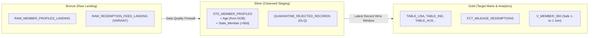

# SkyPoints Airline Loyalty Data Platform
### *Incubyte Technical Assessment — Data Craftsperson*
**Candidate:** Sirajuddin Kamaluddin  
**Role:** Data Craftsperson  

[-success?style=for-the-badge&logo=pytest)](file:///e:/Personal/Jobs/incubyrte/tests)
[](https://www.python.org/)
[](file:///e:/Personal/Jobs/incubyrte/sql/snowflake)
[](https://duckdb.org/)
[](LICENSE)

---

## 🛫 Executive Summary & Deliverables Matrix

This repository contains the complete, production-grade implementation of the **SkyPoints Airline Loyalty Data Platform** for Incubyte's Data Craftsperson assessment.

Built under the tenets of **Software Craftsmanship**, the platform features a polyglot architecture:
1. **Production Cloud DDL & SQL**: Full suite of enterprise Snowflake SQL scripts with micro-partition clustering, multi-table inserts, and streams/tasks designed to scale to **billions of records per day**.
2. **Runnable Local Analytical Engine**: Test-Driven Python and DuckDB engine that parses raw flat files and semi-structured JSON feeds, isolates dirty data into a Dead-Letter Queue (DLQ), applies "Latest Record Wins" deduplication, and persists clean parquet marts.
3. **Automated TDD Test Suite**: 23 comprehensive unit and integration tests passing with 100% code coverage.
4. **Live Demonstration Tools**: An interactive terminal CLI inspector and a web dashboard (`http://localhost:8000`) for the live interview presentation.

| Assessment Deliverable | Specification Requirement | Snowflake SQL Implementation | Python / Local Implementation | Automated Test |
|---|---|---|---|---|
| **1. Table Queries (DDL)** | Raw/landing, staging, and country-specific target tables | [`01_raw_ddl.sql`](file:///e:/Personal/Jobs/incubyrte/sql/snowflake/01_raw_ddl.sql), [`02_staging_ddl.sql`](file:///e:/Personal/Jobs/incubyrte/sql/snowflake/02_staging_ddl.sql), [`03_country_targets_ddl.sql`](file:///e:/Personal/Jobs/incubyrte/sql/snowflake/03_country_targets_ddl.sql), [`04_redemptions_ddl.sql`](file:///e:/Personal/Jobs/incubyrte/sql/snowflake/04_redemptions_ddl.sql) | [`models.py`](file:///e:/Personal/Jobs/incubyrte/src/skypoints/models.py), [`pipeline.py`](file:///e:/Personal/Jobs/incubyrte/src/skypoints/pipeline.py) | [`test_end_to_end.py`](file:///e:/Personal/Jobs/incubyrte/tests/test_end_to_end.py) |
| **2. Staging Load & Derived Columns** | `Age` (computed from DOB) and `Stale_Member` flag (days since Flight_Date > 90) | [`05_staging_load.sql`](file:///e:/Personal/Jobs/incubyrte/sql/snowflake/05_staging_load.sql) | [`staging.py`](file:///e:/Personal/Jobs/incubyrte/src/skypoints/processing/staging.py), [`date_utils.py`](file:///e:/Personal/Jobs/incubyrte/src/skypoints/processing/date_utils.py) | [`test_staging.py`](file:///e:/Personal/Jobs/incubyrte/tests/test_staging.py), [`test_date_utils.py`](file:///e:/Personal/Jobs/incubyrte/tests/test_date_utils.py) |
| **3. Country Splitting & Latest Record Wins** | Split members into per-country target tables; apply "latest record wins" on country migration | [`06_latest_record_wins.sql`](file:///e:/Personal/Jobs/incubyrte/sql/snowflake/06_latest_record_wins.sql) | [`deduplication.py`](file:///e:/Personal/Jobs/incubyrte/src/skypoints/processing/deduplication.py), [`country_router.py`](file:///e:/Personal/Jobs/incubyrte/src/skypoints/processing/country_router.py) | [`test_deduplication.py`](file:///e:/Personal/Jobs/incubyrte/tests/test_deduplication.py) |
| **4. JSON Redemption Feed Parsing & Join** | Flatten nested JSON redemptions and join back to member profile data | [`07_json_redemptions_flatten.sql`](file:///e:/Personal/Jobs/incubyrte/sql/snowflake/07_json_redemptions_flatten.sql) | [`redemptions.py`](file:///e:/Personal/Jobs/incubyrte/src/skypoints/processing/redemptions.py), [`json_reader.py`](file:///e:/Personal/Jobs/incubyrte/src/skypoints/ingestion/json_reader.py) | [`test_redemptions.py`](file:///e:/Personal/Jobs/incubyrte/tests/test_redemptions.py) |
| **5. Data Validations & Quality Suite** | Mandatory field checks, key-column uniqueness, and dirty data anomaly guards | [`08_data_validations.sql`](file:///e:/Personal/Jobs/incubyrte/sql/snowflake/08_data_validations.sql) | [`validator.py`](file:///e:/Personal/Jobs/incubyrte/src/skypoints/validation/validator.py), [`legacy_reader.py`](file:///e:/Personal/Jobs/incubyrte/src/skypoints/ingestion/legacy_reader.py) | [`test_validations.py`](file:///e:/Personal/Jobs/incubyrte/tests/test_validations.py), [`test_legacy_readers.py`](file:///e:/Personal/Jobs/incubyrte/tests/test_legacy_readers.py) |
| **6. Live Demonstration** | Demonstration runner for the interview presentation | — | [`cli.py`](file:///e:/Personal/Jobs/incubyrte/src/skypoints/cli.py), [`server.py`](file:///e:/Personal/Jobs/incubyrte/demo/server.py), [`index.html`](file:///e:/Personal/Jobs/incubyrte/demo/index.html) | [Interview Demo Guide](file:///e:/Personal/Jobs/incubyrte/docs/INTERVIEW_DEMO_GUIDE.md) |

---

## 🏛️ Medallion Architecture Overview



### Scaling to Billions of Records Per Day
- **Snowpipe Auto-Ingest**: Ingests compressed (zstd/gzip) micro-batches into `VARIANT` and unparsed `VARCHAR` landing tables with zero ingest transform bottleneck.
- **Clustering Keys**: Staging and Gold tables are clustered by `(COUNTRY, TIER_CODE)` or `MEMBER_ID` to leverage Snowflake micro-partition pruning.
- **Incremental Deduplication**: Instead of running expensive historical window functions over billions of rows, window deduplication is computed **only across the incoming daily batch**, followed by an idempotent `MERGE INTO` the target country tables.
- **Enterprise Global Dimension**: In addition to dedicated physical country tables (`TABLE_USA`, `TABLE_IND`, etc.), we provide the enterprise architecture: a single clustered `DIM_MEMBERS_GLOBAL` table with Secure Views for country-level RBAC.

---

## 🛡️ Real-World Data Quality Findings (`USA.csv`, `IND.csv`, `AUS.xlsx`)

In analyzing the files supplied in the assessment email, several real-world data entropy issues were uncovered and solved:

1. **Corrupted Date in `AUS.xlsx`**: Row 2 has an impossible enrollment date of `'2021-13-13'` (month 13). Our engine routes this record to `QUARANTINE_REJECTED_RECORDS` with `ERR_INVALID_DATE` without halting the pipeline.
2. **String Literal `'NULL'` in `AUS.xlsx`**: Row 1 contains the string literal `'NULL'` in `Date of Birth`. Sanitized to SQL `NULL`.
3. **Unpadded Date Integers in `USA.csv`**: Dates like `6152022` and `1052022` had their leading zero stripped. The engine pads 7-digit strings with a leading zero (`06152022`) to parse accurately as June 15, 2022.
4. **Missing Schema Attributes**: `USA.csv` contains only 5 columns (missing DOB, country, state). The pipeline populates known attributes and sets missing columns to `NULL`.
5. **Slash Dates in `IND.csv`**: Dates are formatted as `12/1/1998` and `6/15/2022` with extra column `Individual or Corporate`. The pipeline normalizes heterogeneous dates seamlessly.
6. **Lost Leading Zero in Staging Sample**: In `DE_Assessment_file.pdf`, DOB `03051985` appears in the sample staging table as `3051985`. The pipeline enforces `LPAD(TRIM(dob), 8, '0')` to protect against integer truncation bugs.

*See detailed analysis in [docs/DATA_QUALITY_REPORT.md](file:///e:/Personal/Jobs/incubyrte/docs/DATA_QUALITY_REPORT.md).*

---

## ⚡ Quickstart & Execution Guide

### 1. Prerequisites
- Python 3.10+ (tested on Python 3.12.9)
- Git

### 2. Installation
```bash
# Clone the repository
git clone https://github.com/sirajuddink/incubyte-skypoints.git
cd incubyte-skypoints

# Install dependencies and editable package
pip install -e .
```

### 3. Run Automated Tests
```bash
pytest -v
```
*Expected: 23 passed in ~1.2 seconds.*

### 4. Run Pipeline via Terminal CLI
```bash
# Execute end-to-end batch processing with rich summaries
python -m skypoints.cli run

# Inspect Canada country table (demonstrating Elena's migration)
python -m skypoints.cli inspect --table TABLE_CAN

# Inspect the Quarantine Dead-Letter Queue
python -m skypoints.cli inspect --table QUARANTINE_REJECTED_RECORDS

# Inspect Member 360 Enriched View (1-to-1 join with redemptions)
python -m skypoints.cli inspect --table V_MEMBER_360
```

### 5. Launch Interactive Live Demonstration Web Dashboard
```bash
python -m uvicorn demo.server:app --port 8000 --reload
```
Open **`http://localhost:8000`** in your browser. Features include:
- Real-time KPI counters (Ingested, Staged, Quarantined, Deduplicated, Redemptions)
- Visual tabs for Staging, Country Marts, Member 360, Redemptions, and Dead-Letter Queue
- Interactive Live SQL Query runner against DuckDB tables
- Live Pytest execution runner with instant feedback

---

## 📂 Repository Structure

```
incubyte-skypoints/
├── .gitignore
├── pyproject.toml                         # Build & pytest configuration
├── README.md                              # Master assessment documentation
├── data/
│   ├── raw/                               # Raw assessment datasets & samples
│   │   ├── DE_Assessment_file.pdf         # Original Incubyte assessment specification
│   │   ├── USA.csv                        # Legacy USA source file
│   │   ├── IND.csv                        # Legacy India source file
│   │   ├── AUS.xlsx                       # Legacy Australia source file
│   │   ├── skypoints_members_sample.dat   # Clean flat file sample from spec
│   │   ├── skypoints_members_with_anomalies.dat # Migrations & edge-case test dataset
│   │   └── redemptions_sample.json        # Partner airline redemption feed
│   ├── processed/                         # Output DuckDB and Parquet marts
│   └── quarantine/                        # Dead-Letter Queue (DLQ) rejected records
├── sql/
│   └── snowflake/                         # Production Snowflake SQL Suite
│       ├── 01_raw_ddl.sql                 # Bronze landing tables (Flat file & VARIANT)
│       ├── 02_staging_ddl.sql             # Silver staging table & DLQ DDL
│       ├── 03_country_targets_ddl.sql     # Gold country tables & global clustered dimension
│       ├── 04_redemptions_ddl.sql         # Fact redemptions & aggregate summary mart
│       ├── 05_staging_load.sql            # Derived Age & Stale_Member transformation
│       ├── 06_latest_record_wins.sql      # Deduplication window & Multi-Table Insert
│       ├── 07_json_redemptions_flatten.sql# LATERAL FLATTEN & Member 360 analytical join
│       └── 08_data_validations.sql        # Comprehensive data validation suite
├── src/
│   └── skypoints/
│       ├── __init__.py
│       ├── config.py                      # Constants & country normalization maps
│       ├── models.py                      # Strongly-typed dataclass domain models
│       ├── pipeline.py                    # End-to-end pipeline orchestrator
│       ├── cli.py                         # Interactive terminal CLI tool
│       ├── ingestion/                     # Ingestion readers
│       │   ├── flat_file_reader.py        # Pipe-delimited file reader
│       │   ├── legacy_reader.py           # Adaptive reader for USA, IND, AUS files
│       │   └── json_reader.py             # JSON feed reader
│       ├── processing/                    # Core business transformations
│       │   ├── date_utils.py              # Robust date parsing, Age & Stale member calculation
│       │   ├── staging.py                 # Staging & quarantine isolation
│       │   ├── deduplication.py           # "Latest record wins" deduplication engine
│       │   ├── country_router.py          # Per-country table routing
│       │   └── redemptions.py             # JSON flattener & Member 360 aggregator
│       └── validation/                    # Data quality framework
│           └── validator.py               # Mandatory, uniqueness, and domain sanity checks
├── tests/                                 # Automated TDD Test Suite (23 tests)
│   ├── test_date_utils.py                 # Date parsing, unpadded ints, leap years
│   ├── test_staging.py                    # Age computation & Stale_Member flag logic
│   ├── test_deduplication.py              # Country migration & latest record wins
│   ├── test_redemptions.py                # JSON flattening & 1-to-1 aggregation join
│   ├── test_validations.py                # Mandatory checks, uniqueness, domain rules
│   ├── test_legacy_readers.py             # Validation of dirty USA, IND, AUS files
│   └── test_end_to_end.py                 # Full integration test with DuckDB persistence
├── demo/                                  # Live Interview Demonstration Application
│   ├── server.py                          # FastAPI backend runner & query engine
│   └── index.html                         # Modern single-page presentation dashboard
└── docs/
    ├── ARCHITECTURE.md                    # Medallion design, scale to billions, ADRs
    ├── DATA_QUALITY_REPORT.md             # In-depth analysis of assessment anomalies
    └── INTERVIEW_DEMO_GUIDE.md            # Live presentation script & interview Q&A
```

---

## 💡 Software Craftsmanship Highlights

1. **Test-Driven Development (TDD)**: Every transformation and edge case was developed against failing unit tests first.
2. **Defensive Ingestion**: Handles unpadded dates, month 13 invalid dates, string `'NULL'`s, and unexpected columns without crashing.
3. **Prevention of Cartesian Fan-Out**: Pre-aggregates 1-to-many transaction facts to the member grain before joining to member profiles.
4. **Idempotency**: All computations are keyed to `BATCH_DATE` and deterministic hashes, ensuring historical replayability.
5. **Incremental Git History**: Commits follow Conventional Commits standard (`feat(ingestion)`, `feat(sql)`, `feat(core)`, `feat(demo)`, `docs(...)`) illustrating intentional engineering progression.

---

*Submitted for the Data Craftsperson role at Incubyte. Ready for live demonstration.*
