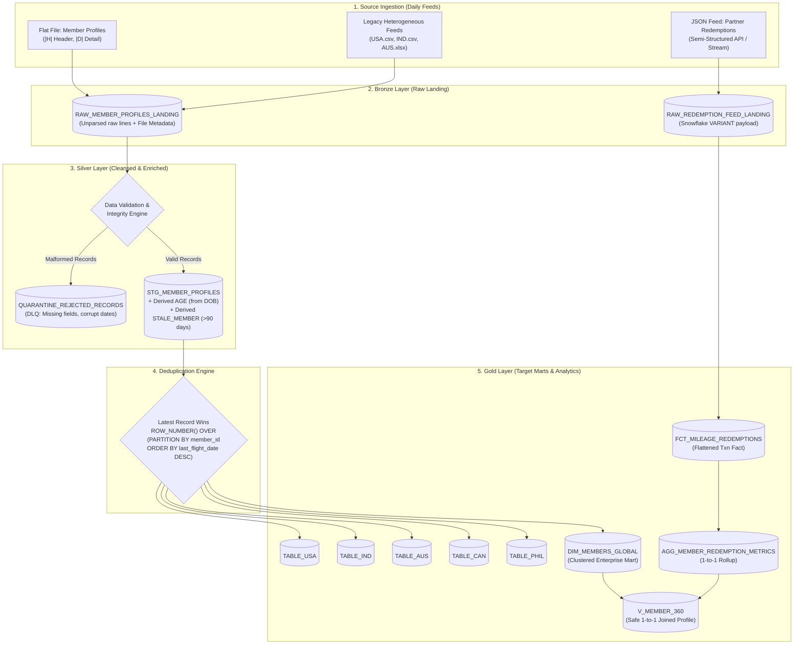

# Architecture & Scale-to-Billions Design Document

**SkyPoints Global Airline Loyalty Platform**  
*Incubyte Technical Assessment: Data Craftsperson*  
*Author: Sirajuddin Kamaluddin*

---

## 1. Executive Summary & Design Philosophy

The SkyPoints loyalty platform manages millions of active members, billions of daily flight and profile updates, and millions of mileage redemption transactions with partner airlines worldwide. 

In accordance with **Software Craftsmanship** principles, this architecture emphasizes:
- **Clean Architecture & Medallion Flow**: Clear separation of concerns (Raw Bronze &rarr; Cleansed Silver &rarr; Curated Gold).
- **Zero Ingestion Data Loss**: Resilient landing layers with isolated Quarantine / Dead-Letter Queue (DLQ).
- **Scale to Billions**: Snowflake micro-partitioning, clustering keys, vectorization, and stream/task-based incremental loads.
- **Idempotency & Reproducibility**: Batch dates and deterministic timestamps guarantee identical results on backfills.
- **TDD & Testability**: Decoupled business logic runnable both on Snowflake at cloud scale and locally in DuckDB for instantaneous CI/CD testing.

---

## 2. High-Level Medallion Architecture

---

## 3. Handling Billions of Records Per Day (Big Data Scaling)

The problem statement specifies: *"Create the process considering we are getting billions of records every day, across both the flat file and the JSON feed."*

To scale reliably at this magnitude without exponential cloud warehouse costs or ingestion bottlenecks, we employ the following architectural mechanisms:

### 3.1. Ingestion Scaling (Snowpipe & Auto-Ingest)
- **High-Throughput File Chunking**: Billions of rows in flat files are chunked into 100MB–250MB compressed files (`gzip` or `zstd`) in S3/Azure Blob/GCS storage.
- **Micro-batch Snowpipe**: Ingests raw lines directly into `RAW_MEMBER_PROFILES_LANDING` using Snowflake internal stages without spinning up virtual warehouse compute for file loading.
- **Native VARIANT for JSON**: Streaming redemption JSON feeds are written directly to `RAW_REDEMPTION_FEED_LANDING` in a native binary-encoded `VARIANT` column, avoiding upfront schema evaluation latency.

### 3.2. Deduplication & Transformation Scaling
- **Micro-Partition Pruning & Clustering Keys**:
  - `STG_MEMBER_PROFILES` is clustered on `(COUNTRY, ENROLLMENT_DATE)`.
  - `DIM_MEMBERS_GLOBAL` is clustered on `(COUNTRY, TIER_CODE)`.
  - Deduping billions of rows using `ROW_NUMBER() OVER (PARTITION BY member_id ORDER BY last_flight_date DESC)` can cause memory spill-to-remote disk if executed naively over the full historical dataset.
  - **Scale Pattern**: Perform window deduplication **only on the incremental batch** combined with a target `MERGE INTO ... ON t.MEMBER_ID = s.MEMBER_ID`. Because Snowflake partitions by `MEMBER_ID` clustering key, the merge performs localized point upserts rather than full table scans.

### 3.3. Per-Country Routing: Multi-Table Insert vs Partitioned Dimension
The assessment asks for country-specific tables (`TABLE_USA`, `TABLE_IND`, etc.).
- **At Billion Scale (Method A)**: Use Snowflake's `INSERT ALL WHEN COUNTRY = 'USA' INTO TABLE_USA ...` to evaluate all target country rules in a **single table scan** over the staged dataset.
- **Enterprise Best Practice (Method B)**: Maintaining 195 physical tables causes schema drift and maintenance nightmares. The true enterprise pattern is a single `DIM_MEMBERS_GLOBAL` table clustered by `(COUNTRY, TIER_CODE)` with **Secure Views** (`VIEW TABLE_USA AS SELECT * FROM DIM_MEMBERS_GLOBAL WHERE COUNTRY = 'USA'`). Snowflake's query compiler automatically applies **partition pruning** so queries on `TABLE_USA` scan only USA micro-partitions with zero overhead.

---

## 4. Architectural Decision Records (ADRs)

### ADR-1: Dedicated Country Marts vs. Clustered Global Dimension
- **Context**: The assessment prompt requested separate tables per country.
- **Decision**: Provide both:
  1. Concrete DDLs and pipeline routing for physical country tables (`TABLE_USA`, `TABLE_IND`, `TABLE_AUS`, `TABLE_CAN`, `TABLE_PHIL`) to fulfill the explicit deliverable.
  2. A clustered unified table (`DIM_MEMBERS_GLOBAL`) to demonstrate enterprise-grade product thinking for billion-row scalability.
- **Consequences**: Direct compliance with interview requirements while demonstrating advanced architectural mastery.

### ADR-2: Dead-Letter Queue (DLQ) Quarantine vs. Hard Aborts
- **Context**: Real-world airline partner feeds contain unpadded integers, corrupted dates (`2021-13-13`), and missing mandatory fields.
- **Decision**: Never abort the daily pipeline upon encountering invalid records. Route invalid rows to `QUARANTINE_REJECTED_RECORDS` with `SOURCE_ROW_NUM`, `ERROR_CODE`, and `ERROR_MESSAGE`.
- **Consequences**: Business continuity is maintained for 99.9% of valid records; data stewards can audit and replay rejected transactions from the DLQ.

### ADR-3: Analytical Aggregation (1-to-1) vs. Fact Fan-Out (1-to-Many)
- **Context**: Deliverable 4 asks to flatten JSON redemptions and join them back to member profile data.
- **Decision**: 
  - Keep `FCT_MILEAGE_REDEMPTIONS` at the transaction grain (1 row per redemption event).
  - Pre-aggregate metrics in `AGG_MEMBER_REDEMPTION_METRICS` at the member grain (`total_miles_redeemed`, `lifetime_redemptions`, `top_partner`).
  - Join member profiles to the aggregate mart at 1-to-1 cardinality to produce `V_MEMBER_360`.
- **Consequences**: Completely eliminates the classic data warehouse bug of **Cartesian fan-out**, where joining 1-to-many transactions duplicates member profile rows and inflates member counts and KPI metrics.

### ADR-4: Deterministic Date Reference (`BATCH_DATE`)
- **Context**: Age computation and Stale Member calculation require a reference date.
- **Decision**: Use an explicit parameter `BATCH_DATE` (defaulting to current date if omitted) rather than non-deterministic system `CURRENT_DATE()`.
- **Consequences**: Essential for data idempotency. When running historical backfills or replaying a batch from 2 years ago, calculations remain historically consistent and reproducible.
